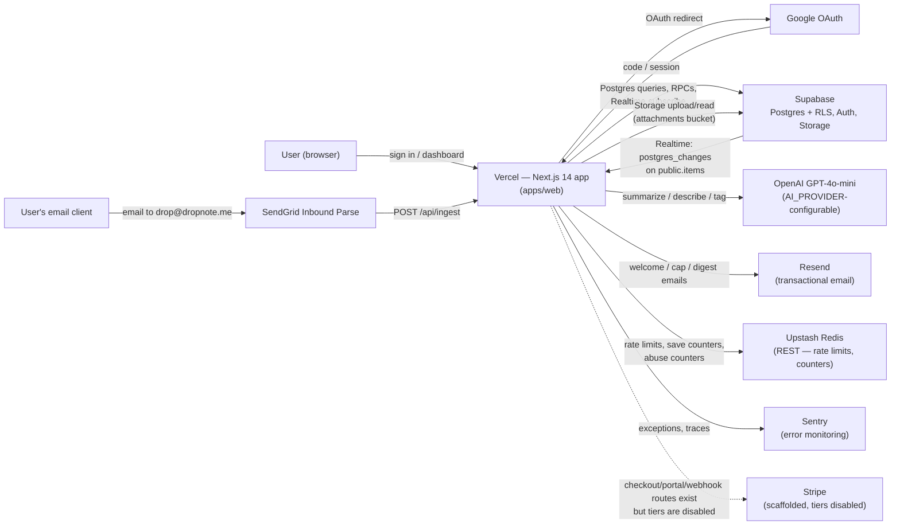
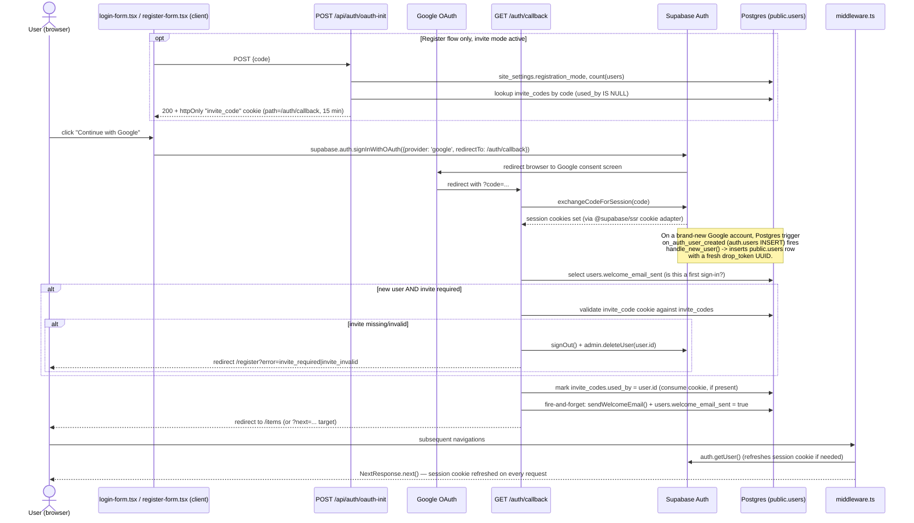
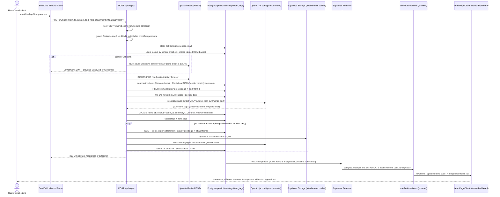
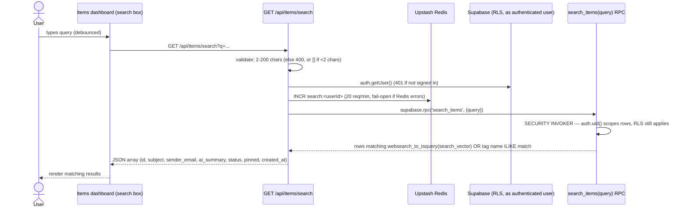
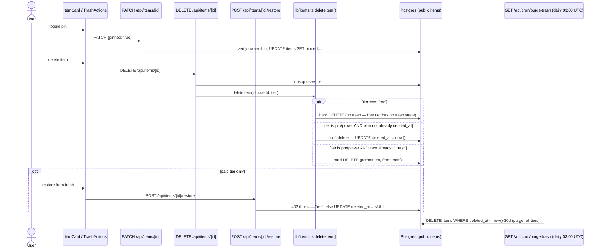

# Architecture Overview

> Living reference. Reflects the code as of 2026-10-11 (beta). For the deeper dive on the
> email → AI pipeline specifically, see [`email-pipeline.md`](email-pipeline.md). This doc
> is the wider picture: system context, request flows, module map, and data model.

## 1. System context

drop-note is a single Next.js app (`apps/web`) on Vercel, backed by Supabase, with a
synchronous AI step and a handful of external services. There is no separate backend/worker
process — everything happens inside Vercel serverless functions.



Notes on the diagram:
- **Stripe is "scaffolded, disabled"**: the routes (`/api/stripe/checkout`, `/api/stripe/portal`,
  `/api/webhooks/stripe`) and `lib/stripe.ts` all exist and are wired up, but per `CLAUDE.md`
  paid tiers are turned off — there is currently no in-app way to reach checkout.
- There is **no queue/worker** — the old BullMQ + Railway worker was removed in "D11"
  (2026-05-26); AI calls happen inline inside the `/api/ingest` serverless function
  (`maxDuration = 60`). See `docs/architecture/email-pipeline.md` for the full rationale.
- Supabase Realtime pushes `postgres_changes` events on `public.items` back to the browser
  over a WebSocket — this is how the dashboard updates live without a refresh (flow 2 below).

## 2. Request flows

### 2.1 Sign-in (Google OAuth via Supabase Auth)

Google OAuth is the only auth method (no passwords, no magic links). The flow differs slightly
for `/login` (no invite gating) vs `/register` (invite gating once the user count passes a
threshold or `site_settings.registration_mode = 'invite'`).



Note: `middleware.ts` also contains a redirect-unauthenticated-users check, but it only matches
the literal path `/dashboard` — and `(dashboard)` in the file tree is a Next.js **route
group**, which never appears in the URL. `/dashboard` itself is just a one-line redirect to
`/items`. So that middleware redirect never actually guards a page with real data; the actual
auth boundary for `/items`, `/trash`, `/archive`, `/settings`, etc. is each page's own
server-side `getUser()` + `redirect('/login')` call. Middleware's only *load-bearing* job today
is refreshing the session cookie on every request.

### 2.2 Email ingest → AI summarize/tag → DB → realtime dashboard

This is the core product loop. SendGrid's Inbound Parse webhook is the only entry point; there
is no polling. Processing is fully synchronous inside the request — see
[`email-pipeline.md`](email-pipeline.md) for the "why synchronous" decision record.



Key behaviors worth calling out:
- `/api/ingest` **always returns HTTP 200** — SendGrid retries on any non-2xx, so unknown
  senders, blocked senders, rate-limited users, and cap-exceeded users are all silently
  discarded with `200` to avoid retry storms.
- The realtime hook (`apps/web/hooks/useRealtimeItems.ts`) opens one Supabase Realtime channel
  per user (`items:<userId>`), with a client-supplied `filter: user_id=eq.<uid>`. That filter
  is an optimization, not the security boundary — the actual authorization is the `items:
  select own` RLS policy, which Realtime enforces server-side per connection regardless of what
  filter the client asks for. The hook also has no reconnect/error handling on `.subscribe()`
  (no `CHANNEL_ERROR`/`TIMED_OUT` callback) — a dropped WebSocket fails silently and only
  resyncs on the next full navigation/`router.refresh()`.
- Body summarization and attachment summarization are two separate AI calls (plus a vision
  call per image, a text-extract+summarize pair per PDF) — there is no batching.

### 2.3 Search



`search_vector` is a generated, stored `tsvector` column on `items` (English config) over
`subject || ai_summary || notes`, backed by a GIN index. Tag matches are a case-insensitive
`LIKE` against tag names, unioned with the full-text match inside the same RPC. The RPC was
rewritten from `SECURITY DEFINER` to `SECURITY INVOKER` (migration `s4_rpc_security_fix`)
specifically because the original version accepted a caller-supplied `p_user_id` and let any
anon-key caller read another user's items — worth knowing if touching these RPCs again.

A few things "search" does *not* do: results are `ORDER BY created_at DESC` only — there is no
`ts_rank`, so it's a recency-sorted filter, not relevance-ranked search. Results are capped at
`LIMIT 50` with no pagination. Only `type = 'email_body'` rows are searched (attachment items
are excluded). And unlike the `/items` list page (which filters `archived_at IS NULL`),
`search_items` has no `archived_at` filter — archived items remain searchable, which may or may
not be intentional.

### 2.4 Delete / pin



## 3. Module map

```
drop-note/
├── apps/web/
│   ├── app/
│   │   ├── (auth)/login, (auth)/register        — Google OAuth sign-in/up, invite-code gate
│   │   ├── (dashboard)/dashboard                 — redirects to /items (not a real page)
│   │   ├── (dashboard)/items                     — main dashboard: list, filters, search, stats
│   │   ├── (dashboard)/items/[id]                — item detail (+ group_id attachment lookup)
│   │   ├── (dashboard)/archive, /trash, /settings
│   │   ├── (admin)/admin/*                       — users, blocks, invite-codes, stats (is_admin-gated)
│   │   ├── api/ingest                            — SendGrid webhook entry point (see 2.2)
│   │   ├── api/items/[id]                        — PATCH (pin/notes/tags/archive), DELETE (tier-aware)
│   │   ├── api/items/route.ts                     — DELETE only: bulk delete (no list/create here —
│   │   │                                              listing is a direct Supabase query inside
│   │   │                                              items/page.tsx; creation happens via /api/ingest)
│   │   ├── api/items/search, bulk-tag, trash, [id]/restore
│   │   ├── api/auth/oauth-init, auth/callback     — invite-code pre-check + OAuth code exchange
│   │   ├── api/admin/*                           — admin-only REST endpoints
│   │   ├── api/cron/digest, cron/purge-trash      — Vercel Cron (vercel.json)
│   │   ├── api/stripe/*, webhooks/stripe          — scaffolded, inert while tiers are disabled
│   │   └── api/account/delete, api/og             — account deletion, OG image generation
│   ├── lib/
│   │   ├── ingest/{process-email,ai,db,storage,pdf}.ts — the synchronous AI pipeline (2.2)
│   │   ├── supabase/{client,server,middleware,admin}.ts — the 4 Supabase client factories
│   │   ├── items.ts                              — deleteItem/deleteItems tier-aware logic (2.4)
│   │   ├── email.ts, emails/*                     — Resend sends (welcome, cap, save-limit)
│   │   ├── redis.ts, stripe.ts, stripe-customer.ts, design-tokens.ts, utils.ts
│   │   └── auth/require-admin.ts
│   ├── components/
│   │   ├── items/*        — ItemsPageClient + card layouts (grid/list/gallery), filters, bulk actions
│   │   ├── dashboard/*     — onboarding panel, welcome modal
│   │   ├── layout/*        — sidebar, mobile sidebar
│   │   ├── landing/, marketing/ — public marketing site
│   │   └── ui/             — shadcn/ui primitives
│   ├── hooks/useRealtimeItems.ts  — the Supabase Realtime subscription (2.2)
│   └── middleware.ts        — session-cookie refresh on every request (its /dashboard redirect
│                                is dead code — see §2.1 note); real auth gating is per-page
├── packages/shared/src/      — @drop-note/shared, imported by apps/web
│   ├── ai-provider.ts        — OpenAIProvider/AnthropicProvider/GeminiProvider + factory
│   ├── prompts.ts            — the summarize/describe prompt text
│   ├── auth.ts, email.ts, html.ts, url.ts, tags.ts, tier.ts, ratelimit.ts, stripe-helpers.ts
│   ├── env.ts                 — requireEnv() guard (never called at module scope)
│   └── database.types.ts      — generated Supabase types (`pnpm gen:types`)
├── supabase/migrations/       — 20 SQL files, additive (see §4)
├── e2e/                        — Playwright: smoke, auth, admin, critical-path, stripe-upgrade
└── docs/                       — this file + STYLE_GUIDE, oauth setup, email-pipeline, .mic-state
```

## 4. Data model

8 tables in the `public` schema, all with RLS enabled. The initial 8-table shape
(`20240001000000_initial_schema.sql`) has since grown columns via additive migrations —
no tables have been added or removed since alpha.

| Table | Purpose | Notable columns added after the initial migration |
|---|---|---|
| `users` | Extends `auth.users` 1:1 (same `id`, `ON DELETE CASCADE`) | `updated_at`, `welcome_email_sent`, `digest_enabled` |
| `items` | Saved content — one row per email body *or* per attachment | `notes`, `group_id` (unused — see §5), `search_vector` (generated tsvector), `source_type`/`source_url`/`thumbnail_url`, `archived_at`, `updated_at` |
| `tags` | Per-user tags, case-insensitive unique | `tags_user_id_name_key` UNIQUE(user_id, name), plus the original `lower(name)` index |
| `item_tags` | Many-to-many join (`item_id`, `tag_id`) | — |
| `site_settings` | Key/value: `registration_mode` (open/invite), `open_slots` | — |
| `block_list` | Email/IP blocklist, admin-managed or auto (unknown-sender abuse) | `type` promoted text→ENUM, UNIQUE(type, value), `created_by` (nullable = system-added) |
| `invite_codes` | Invite-code gate once registration passes 50 users (or `site_settings` forces invite mode) | — |
| `usage_log` | Monthly free-tier save-action tracking (admin reporting; the actual cap check lives in Redis) | CHECK on `month` format `YYYY-MM` |

RLS model: every table restricts rows to `auth.uid()` (directly, or via an `EXISTS` join
through `items`/`tags` for `item_tags`), except `block_list`/`invite_codes`/`site_settings`
writes which require `is_admin = true`, and `invite_codes` claiming which allows any
authenticated user to UPDATE an unclaimed row to set `used_by = auth.uid()` (locked down by a
`WITH CHECK` that forbids changing `code`/`created_by`). Three RPCs (`search_items`,
`get_tags_with_counts`, `get_month_counts`) run `SECURITY INVOKER` so RLS applies to them too —
they were originally `SECURITY DEFINER` with a caller-supplied user ID, which was a privilege
escalation bug fixed in `20260326000006_s4_rpc_security_fix.sql`.

A Postgres trigger `on_auth_user_created` (`AFTER INSERT ON auth.users`, `SECURITY DEFINER`)
auto-creates the matching `public.users` row with a fresh `drop_token` UUID on every sign-up —
see flow 2.1.

Storage: one private bucket (`attachments`), RLS-equivalent policy on `storage.objects`
restricts `SELECT` to paths whose first folder segment equals `auth.uid()`; all writes go
through the service-role key (`supabaseAdmin`) from the ingest pipeline.

## 5. What surprised me

- **`items.group_id` is dead on arrival.** The column (and its index) were added in
  `20260326000004_s4_items_notes_group_id.sql` with the stated purpose "links all items from
  the same email ingest (body + attachments), set by worker." The item detail page
  (`app/(dashboard)/items/[id]/page.tsx`) already reads it to fetch sibling attachments. But
  `createAttachmentItem()` in `lib/ingest/db.ts` never sets `group_id` on insert — grep finds
  no write site anywhere in the codebase. In practice every attachment shows up as an
  unrelated top-level item in the dashboard; the "email with 3 photos groups together" UX this
  column implies does not currently work.
- **Trash/restore is effectively unreachable today.** `deleteItem()` only soft-deletes
  (moves to trash) for `pro`/`power` tiers; free tier always hard-deletes immediately, and
  `/api/items/[id]/restore` + `DELETE /api/items/trash` both 403 for free tier. Since
  `CLAUDE.md` confirms paid tiers are disabled until 100 active users, **no current user can
  reach trash or restore** — deletes are permanent for everyone right now, even though a full
  trash UI (`(dashboard)/trash/*`) and a daily purge cron exist and are exercised in e2e tests.
- **The email pipeline silently does URL/YouTube link detection**, not just "summarize the
  email." `processEmail()` runs `extractSingleUrl`/`extractYouTubeId` before summarizing, and
  tags the item `source_type: 'youtube' | 'url' | 'email'` with a thumbnail for video links.
  This logic (migration `20260327000001_s2_url_detection.sql`) isn't mentioned in
  `docs/architecture/email-pipeline.md`'s flow diagram at all.
- **Middleware's redirect-to-login guard is effectively dead code** (see §2.1) — it only
  matches the literal `/dashboard` path, which is itself just a redirect to `/items`, because
  `(dashboard)` is a route group and never appears in the URL. A new page added under
  `(dashboard)/` would *not* get middleware protection "for free" the way the code comment
  implies; it needs its own `getUser()` check like every other page there already has.
- **Invite-code validation happens twice, after the Google identity already exists.**
  `/api/auth/oauth-init` pre-validates the code before the OAuth redirect (to set a cookie),
  but the *actual* enforcement is in `/auth/callback`, after Supabase has already created the
  `auth.users` row (and the trigger has already created the `public.users` row). An invalid
  code at that point means callback calls `supabase.auth.signOut()` *and*
  `supabaseAdmin.auth.admin.deleteUser(user.id)` to undo the signup — a real Google account
  momentarily exists in Supabase Auth before being deleted if the invite check fails. (No
  orphan-row risk from this: `public.users.id` references `auth.users(id) ON DELETE CASCADE`,
  so deleting the auth user cleanly removes the `public.users` row, `drop_token` included.)
- **The daily trash-purge cron fails silently-safe, not silently-open.** If `CRON_SECRET` is
  ever unset in the Vercel env, `/api/cron/purge-trash` and `/api/cron/digest` both just log a
  warning and return `{ skipped: true }` with HTTP 200 — they don't error, and nothing pages
  anyone. An unset `CRON_SECRET` would mean trash quietly stops being purged (or digests stop
  sending) with no visible failure in Vercel's cron dashboard.
- **`REDIS_URL`/BullMQ in `.env.example`** is a leftover from the pre-D11 worker architecture;
  the live app only uses `@upstash/redis` (REST). Not wrong, just stale.

---

Sources: direct reading of `apps/web/app/api/ingest/route.ts`, `lib/ingest/process-email.ts`,
`lib/items.ts`, `hooks/useRealtimeItems.ts`, `app/auth/callback/route.ts`,
`app/api/auth/oauth-init/route.ts`, `lib/supabase/middleware.ts`, `app/api/items/search/route.ts`,
`app/api/items/[id]/route.ts`, `app/api/items/[id]/restore/route.ts`,
`app/api/items/trash/route.ts`, `app/api/cron/purge-trash/route.ts`, all 20 files under
`supabase/migrations/`, and `packages/shared/src/*`.
